<!-- Generated by scripts/render.py. Edit profile.config.json or scripts, not this file. -->
<picture><source media="(max-width: 1100px)" srcset="./assets/art/opening-phone.svg"></picture>

<picture><source media="(max-width: 1100px)" srcset="./assets/art/transmission-phone.svg"></picture>

<b>Tonight's message</b> · it can be read by hand

 

<picture><source media="(max-width: 1100px)" srcset="./assets/art/message-phone.svg">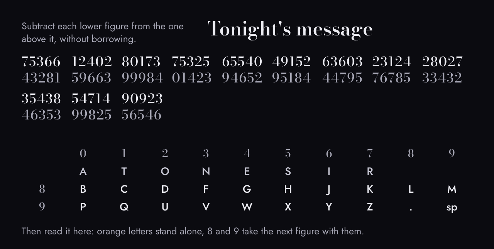</picture>

<picture><source media="(max-width: 1100px)" srcset="./assets/art/array-phone.svg">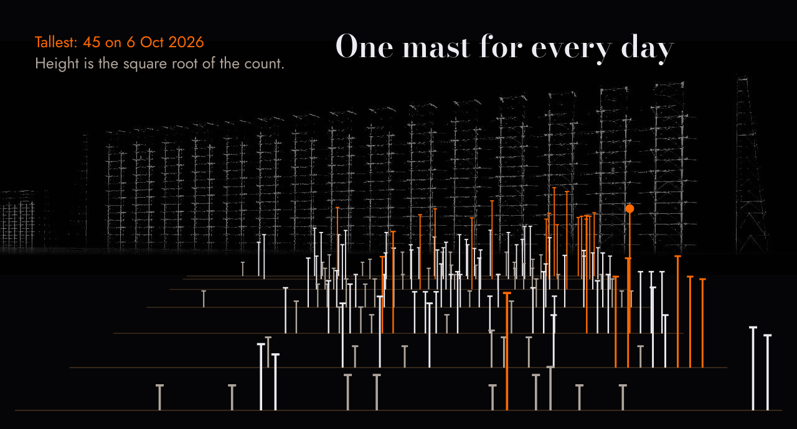</picture>

<picture><source media="(max-width: 1100px)" srcset="./assets/art/bands-global-phone.svg">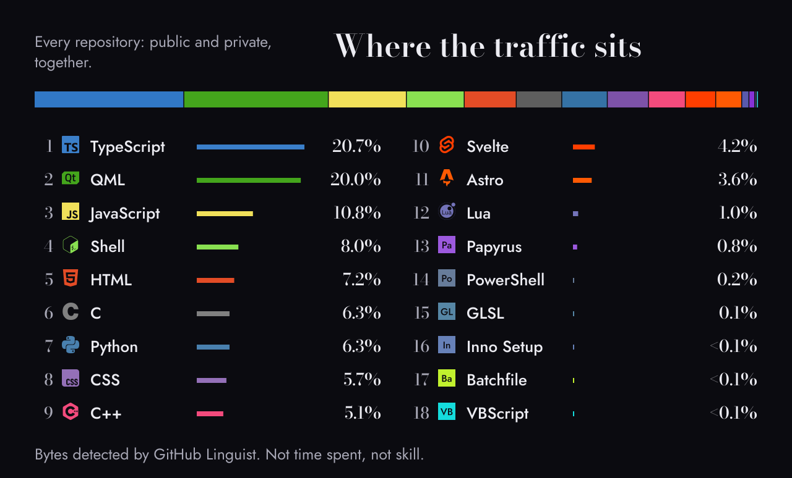</picture>

<b>Public</b> · HTML leads, 12 in all

 

<picture><source media="(max-width: 1100px)" srcset="./assets/art/bands-public-phone.svg">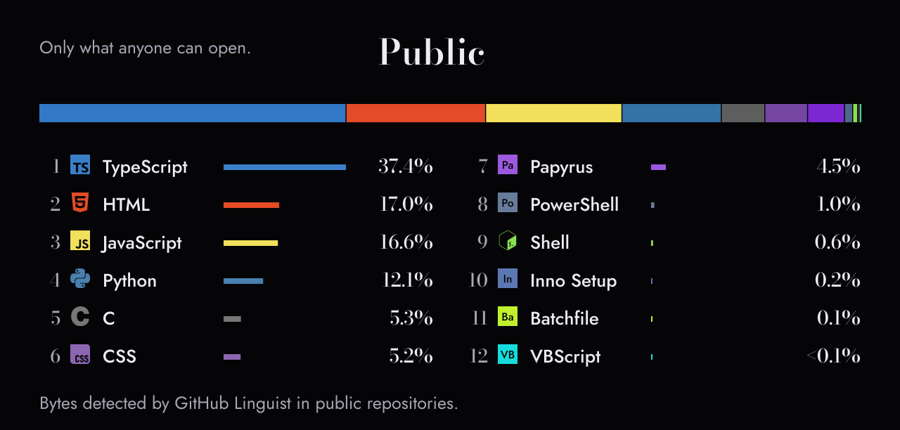</picture>

<b>Private</b> · TypeScript leads, 14 in all

 

<picture><source media="(max-width: 1100px)" srcset="./assets/art/bands-private-phone.svg">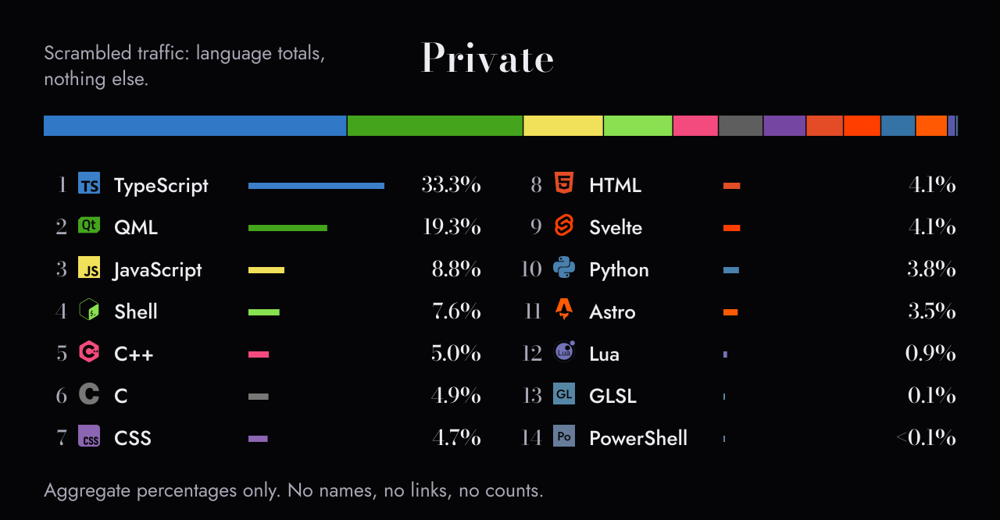</picture>

<b>Contributions</b> · Astro

 

<picture><source media="(max-width: 1100px)" srcset="./assets/art/bands-contributions-phone.svg">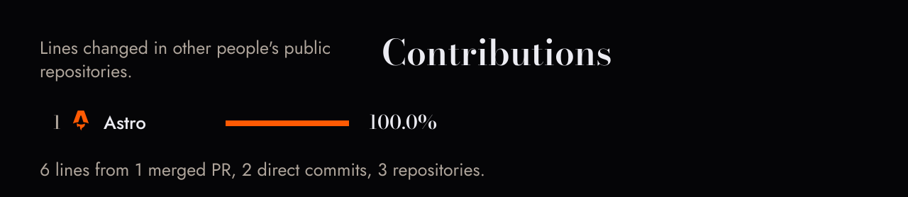</picture>

<a href="https://github.com/rx3card/click-to-source"><picture><source media="(max-width: 1100px)" srcset="./assets/art/project-click-to-source-phone.svg">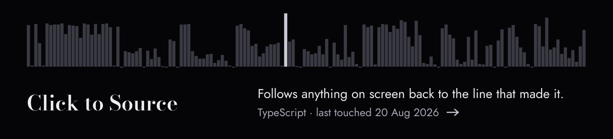</picture></a>

<a href="https://github.com/rx3card/cfetch"><picture><source media="(max-width: 1100px)" srcset="./assets/art/project-cfetch-phone.svg">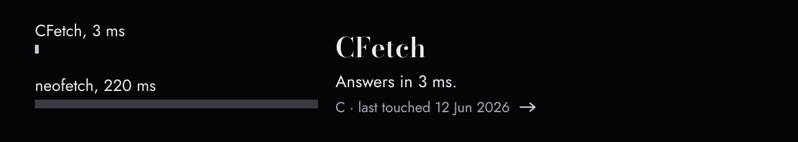</picture></a>

<a href="https://github.com/rx3card/Whatsapp-Archiver"><picture><source media="(max-width: 1100px)" srcset="./assets/art/project-whatsapp-archiver-phone.svg">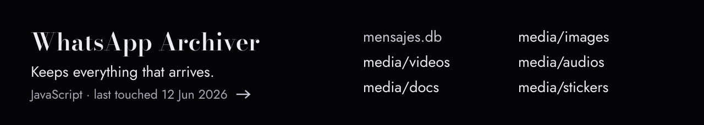</picture></a>

<a href="https://github.com/rx3card/encrypted-text-editor"><picture><source media="(max-width: 1100px)" srcset="./assets/art/project-encrypted-text-editor-phone.svg">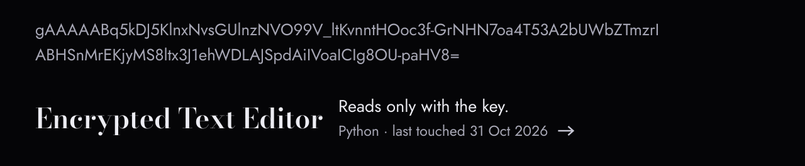</picture></a>

<picture><source media="(max-width: 1100px)" srcset="./assets/art/closing-phone.svg">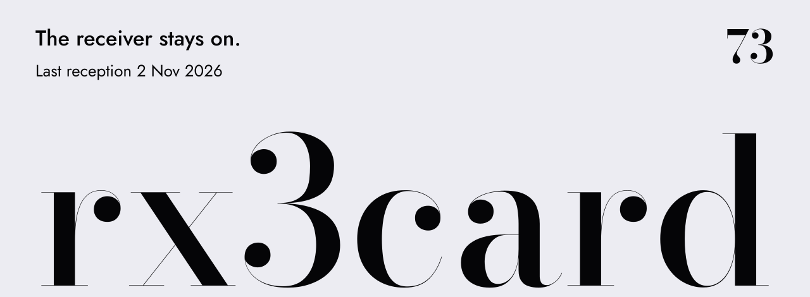</picture>

Dish: Gar Lunney, 1960, public domain. Duga array: Ingmar Runge, CC BY 3.0, recoloured. Type: Bodoni Moda and Jost, SIL OFL. <a href="./ASSET_SOURCES.md">Sources</a> · <a href="./DATA_METHODOLOGY.md">How the figures are made</a>
